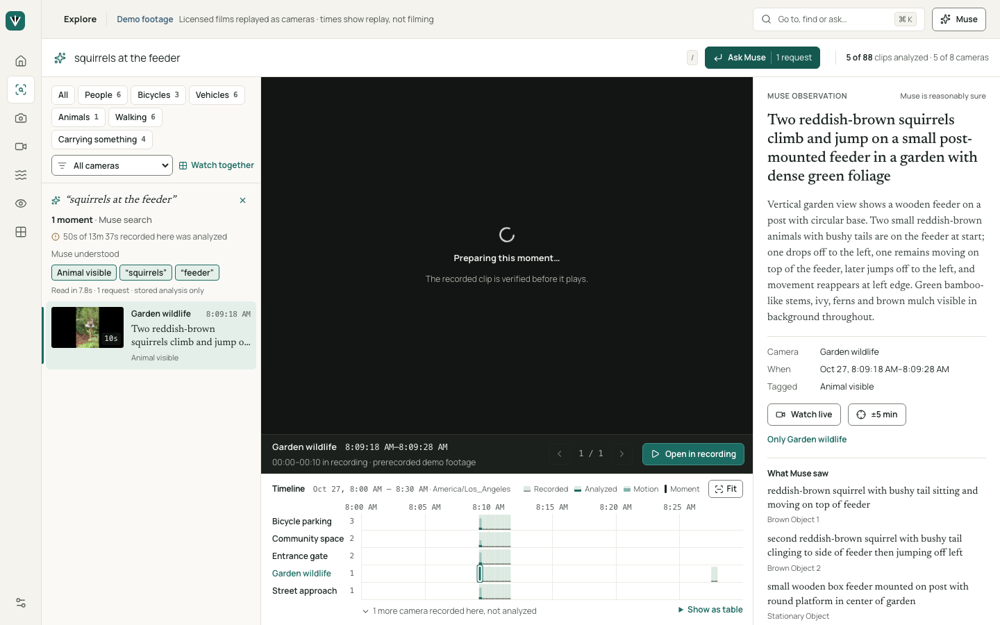
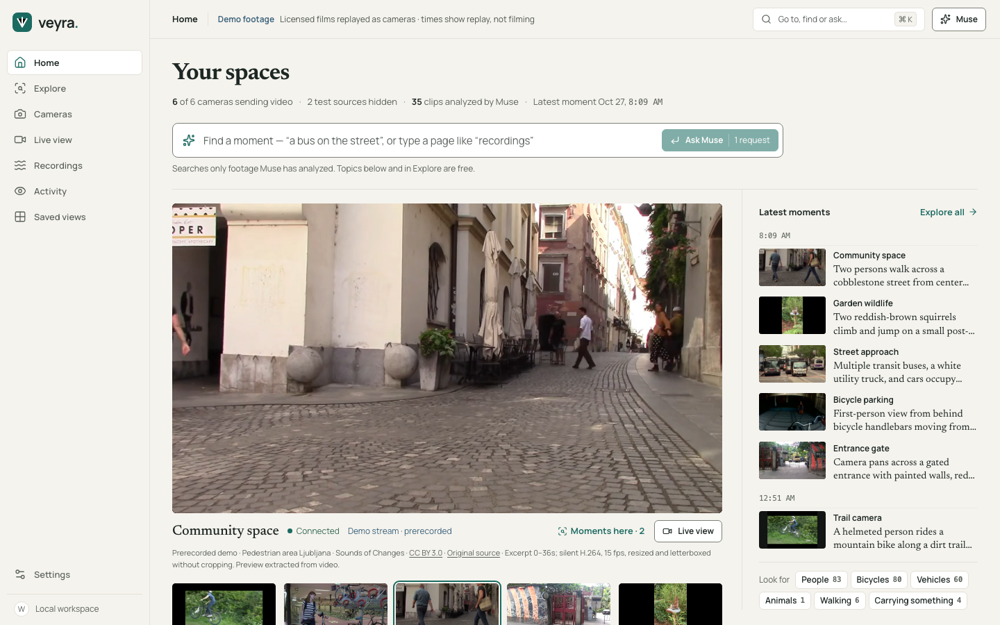
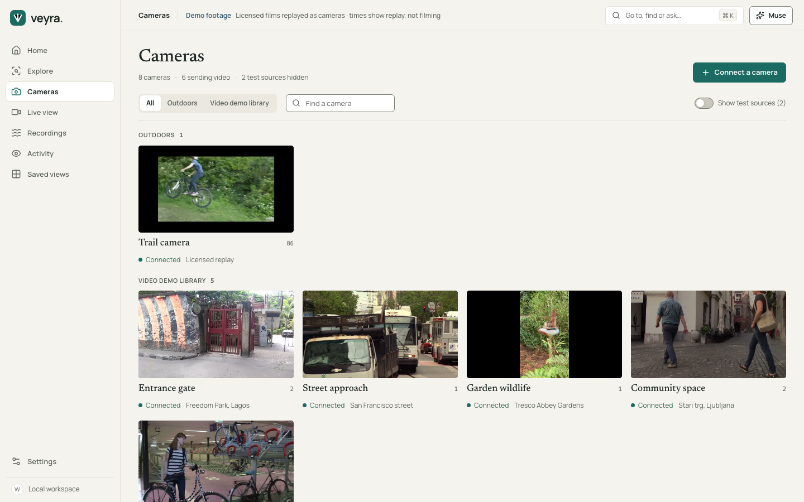
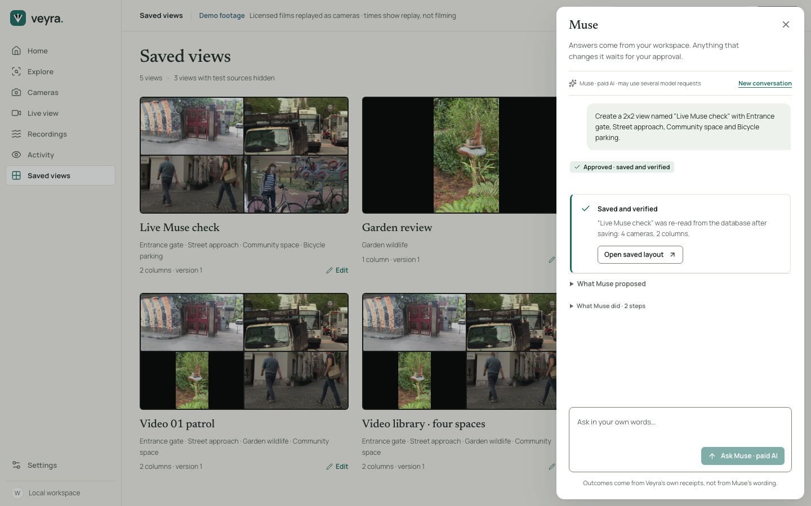
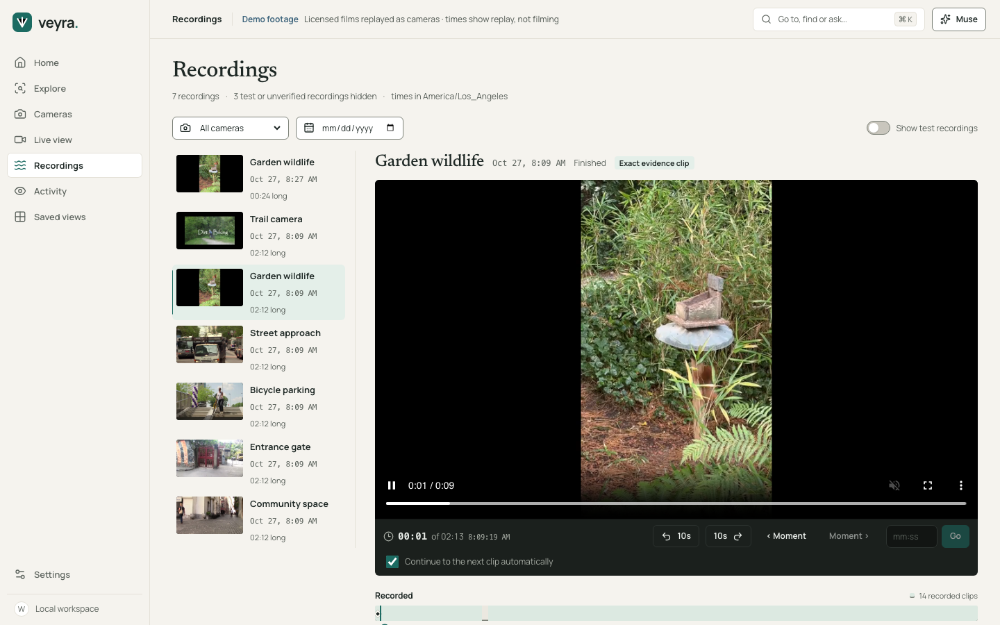

# Veyra — an agentic video workspace built on Meta Muse

Veyra is a video management system (VMS) where you can ask for what you need in plain language.
**Meta Muse** reads your cameras and recorded video, proposes concrete actions through typed
tools, and finds the exact moment in real footage that matches a description. Every change
waits for your approval and is verified against the database before Veyra says it is done.



## Why it is different

Most video software is either a wall of feeds or a chatbot bolted on top. Veyra joins them
without letting the model act unchecked:

- **Evidence, not claims.** A search answer is a clip you can play at the exact second, with
  Muse's own description, its uncertainty and what was or was not analysed.
- **Agentic, but approved.** Muse may only call 13 allowlisted, typed tools. The single
  mutating tool (`layouts.create`) always needs a server-bound, expiring, single-use approval;
  the result is re-read from PostgreSQL before "Saved and verified" appears.
- **Spend is visible and bounded.** Navigation, filters and refinements are free; paid calls
  are labelled, deduplicated and capped per UTC day on the server.

## Meta Muse integration

| Use | How |
| --- | --- |
| Agentic actions | `muse-spark-1.3` via the Meta Model API (`api.meta.ai/v1`), tool calls + JSON-schema answers, ≤ 8 turns per message, 2,048 output tokens per turn |
| Video understanding | A worker sends bounded, consented clips to Muse and stores grounded observations (objects, events, descriptions, uncertainty) per segment |
| Natural-language search | One Muse call turns words into typed constraints; retrieval then runs over PostgreSQL full-text and structured fields, and refinements reuse the parsed constraints |
| Navigation | Muse can open features, cameras, views and recordings it found through tools |

**Live verification (28 Oct 2026, isolated copy):** "squirrels at the feeder" → the exact Garden
wildlife squirrel clip, played; a 2×2 view of four named cameras proposed, approved, saved and
verified. 3 model requests, 9,001 input / 1,969 output tokens. See
[FINAL_E2E_RESULTS](docs/qa/FINAL_E2E_RESULTS.md#live-meta-muse-session-paid-28-oct-2026-0240-utc).

## Architecture

```text
Browser ── Next.js 16 (React 19) ──► /api/v1 proxy (server-side token) ──► FastAPI
                                                                   │
            Meta Model API (Muse) ◄── agent + search + index worker ┤
                                                                   ├─► PostgreSQL 15 (cameras, layouts,
MediaMTX ◄── FFmpeg publishers (licensed films replayed as RTSP)    │    recordings, segments, observations,
   │ HLS live / finalized MP4 segments ──────────────────────────────┘    confirmations, audit, usage ledger)
```

| Path | Contents |
| --- | --- |
| `apps/web/` | Next.js product UI (Editorial Video Workspace design, [DESIGN.md](DESIGN.md)) |
| `apps/api/veyra/` | FastAPI services, Muse tools and approvals, media sessions, indexing, retrieval |
| `apps/api/tests/` | Backend tests on throwaway PostgreSQL clusters (scripted provider) |
| `infra/migrations/` | SQL migrations |
| `scripts/` | Native stacks (`demo_videos.py`, `final_rc.py`), acceptance tools |
| `docs/` | Product, architecture, design, QA evidence, demo guides |

## Run the demo locally

Prerequisites: Node 22, Python 3.12 with uv, PostgreSQL 15 binaries, FFmpeg/FFprobe, MediaMTX
1.21.3, Playwright Chromium. Install the locked dependencies with `make install`, copy
`.env.example` to a private `.env` and set `MODEL_API_KEY` plus positive
`MODEL_DAILY_BUDGET_USD` / `MODEL_REQUEST_RESERVE_USD` for Muse.

```sh
cd apps/web && npx next build --webpack && cd ../..
.venv/bin/python -E scripts/demo_videos.py --mediamtx /path/to/mediamtx --runtime runtime/demo --port 3200
```

Open **http://127.0.0.1:3200**. Full start/check/stop commands and a 2-minute script:
[FINAL_DEMO_GUIDE](docs/demo/FINAL_DEMO_GUIDE.md). The stack binds loopback only and is a
single-user local workspace; do not expose it publicly.

## Tests

```sh
make check                    # ruff, pytest (192 + 1 skipped), tsc, contract checks
cd apps/web && npm run lint && npx prettier --check src tests
# Isolated release stack (fresh DB copy each run; scripted Muse on :3701 only)
.venv/bin/python -E scripts/final_rc.py --qa-provider
VEYRA_QA_URL=http://127.0.0.1:3701 node tests/final-integration.mjs   # 10/10
node tests/redesign02-flows.mjs http://127.0.0.1:3700                # 39/39
```

Scripted-provider tests are never reported as live Meta results. A capped live session uses
`scripts/final_rc.py --live-muse-requests 4 --port 3710` with `tests/live-muse-verification.mjs`.

## Screenshots

| | |
| --- | --- |
|  |  |
|  |  |

## Limitations

- Prerecorded licensed films replayed as cameras; physical cameras, Docker/Compose and
  Safari/iOS are not verified.
- The demo index is small (5 of 88 curated clips analysed; 35 clips in the whole demo DB).
  Search is lexical/structured and can miss synonyms; a no-match is not proof of absence.
- Muse is nondeterministic; live behaviour was verified in one bounded session, not at scale.
- Actual Meta billing is not exposed by the API; spend is reported from tokens and list price.
- Full list: [KNOWN_LIMITATIONS](docs/qa/KNOWN_LIMITATIONS.md).

## Media and licensing

All footage is third-party video from Wikimedia Commons, used under its Creative Commons
licence: trimmed, silent H.264, resized and letterboxed without cropping. Provenance and
hashes: [VIDEO_ASSET_MANIFEST](docs/demo/VIDEO_ASSET_MANIFEST.md).

| Camera | Source | Author | Licence |
| --- | --- | --- | --- |
| Entrance gate | [Freedom Park-Entrance Gate 2](https://commons.wikimedia.org/wiki/File%3AFreedom_Park-Entrance_Gate_2.webm) | Olusola David, Ayibiowu | CC BY-SA 4.0 |
| Street approach | [Street traffic](https://commons.wikimedia.org/wiki/File%3AStreet_traffic.webm) | Editor (YouTube) | CC BY 3.0 |
| Garden wildlife | [Red squirrels in Tresco Abbey Gardens](https://commons.wikimedia.org/wiki/File%3ARed_squirrels_in_Tresco_Abbey_Gardens.webm) | andrewrabbott | CC BY 4.0 |
| Community space | [Pedestrian area Ljubljana](https://commons.wikimedia.org/wiki/File%3APedestrian_area_Ljubljana.webm) | Sounds of Changes | CC BY 3.0 |
| Bicycle parking | [Nieuwe fietsenstalling Jaarbeursplein Utrecht](https://commons.wikimedia.org/wiki/File%3ANieuwe_fietsenstalling_Jaarbeursplein_Utrecht.webm) | ProRail | CC BY 3.0 |
| Trail camera | [Dirt jump biking](https://commons.wikimedia.org/wiki/File%3ADirt_jump_biking.webm) | Henry Geer | CC BY 3.0 |
| Station entrance (spare source, used by the registration test) | [8 Street station entrance vc](https://commons.wikimedia.org/wiki/File%3A8_Street_station_entrance_vc.ogv) | rym (Flickr) | CC BY 2.0 |

The repository has no licence file of its own; choose one before publishing the code.

## Further reading

[HANDOFF](docs/HANDOFF.md) · [FINAL_RELEASE_GATES](docs/qa/FINAL_RELEASE_GATES.md) ·
[FINAL_INTEGRATION_REPORT](docs/qa/FINAL_INTEGRATION_REPORT.md) ·
[FINAL_SECURITY_REVIEW](docs/qa/FINAL_SECURITY_REVIEW.md) · [AGENTS](AGENTS.md) ·
[API contract](docs/architecture/API_CONTRACT.md) · [agent tools](docs/architecture/AGENT_TOOLS.md)
