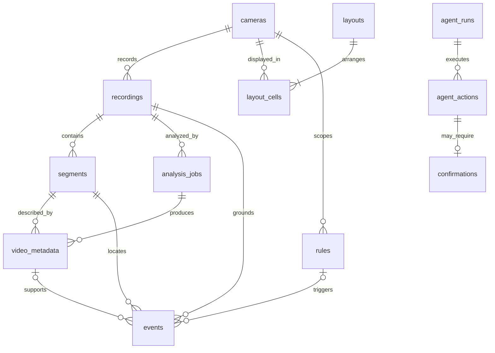

# Data model — v0.1.0

**Phase 05:** [004_indexing.sql](../../infra/migrations/004_indexing.sql) implements the
versioned indexing/usage model described below. Earlier status paragraphs are historical.

**Phase 03:** migration [002_vms.sql](../../infra/migrations/002_vms.sql) extends this model;
the original migration remains unchanged. See the implementation notes at the end.

Persistent source of truth: [`001_initial.sql`](../../infra/migrations/001_initial.sql).
Wire schemas: `apps/api/veyra/contracts.py` and additive `models.py`. SQL supports PostgreSQL 15+
and Compose targets PostgreSQL 16. The actual tested server version is in FEASIBILITY.

## Entities

| Entity | Key fields | Relationships / invariants |
| --- | --- | --- |
| `cameras` | UUID, name, unique source_id, unique private media_path, enabled, cloud_analysis_allowed, status, last_observed_at, created_at | Source ID is an operator-config reference; URL/credentials never stored here. Unknown until observed. |
| `recordings` | UUID, camera_id, started_at, ended_at?, status, available_duration_ms | One camera, contiguous available recording session. End > start. Duration sums finalized available segments. |
| `segments` | UUID, recording_id, private storage_key, started_at, duration_ms, offset_ms, status, checksum_sha256? | Unique storage key and `(recording_id,offset_ms)`. Only closed verified files become ready. |
| `layouts` | UUID, name, columns 1/2/3, version, created_at, updated_at | Replace using optimistic version; increment within transaction. |
| `layout_cells` | composite `(layout_id,position)`, camera_id | Position 0–8, unique camera per layout. Cascade cells only when layout is deleted. No cascading camera/recording deletion. |
| `rules` | UUID, camera_id, name, kind=motion, enabled=false, JSONB config | Reserved motion-rule configuration. No executable expressions or arbitrary URLs. Secondary scope. |
| `analysis_jobs` | UUID, recording_id, state, progress, attempts, model_id, prompt_version, lease_expires_at?, error_code?, timestamps | At most one queued/running job per recording. Attempts ≤3, progress 0–1. Worker lease makes restart recoverable. |
| `video_metadata` | UUID, segment_id, analysis_job_id, summary, evidence_text, observation_start/end_ms, model/prompt/schema versions, sampled_offsets_ms, raw_output, indexed_at, generated search_document | A grounded observation within one clip/segment. Many observations per segment. Raw output stays private. |
| `events` | UUID, camera_id, recording_id, segment_id, optional rule/metadata IDs, kind, start/end, summary, provenance, model_id?, evidence_offset_ms | Composite FKs ensure camera/recording/segment match. Muse provenance requires metadata and model ID. |
| `agent_runs` | UUID, conversation_id, principal_id, state, model_id, created_at | Authorization context belongs to server principal. Conversation ID is not a credential. |
| `agent_actions` | UUID, run_id, unique tool_call_id per run, tool_name, arguments, state, result, created_at | Typed tool audit; no raw secrets. One action may have one confirmation. |
| `confirmations` | UUID, unique action_id, principal_id, arguments_sha256, expires_at, decided_at?, approved? | Server-bound, single-use decision. Hash includes canonical args and relevant resource versions. |
| `idempotency_keys` | composite `(principal_id,operation,key)`, request_sha256, response_status/body, created_at | Reserve key, execute mutation and record result atomically; request hash mismatch conflicts. |
| `schema_migrations` | version, SHA256, applied_at | Created by migration runner, not product SQL. Applied migrations cannot be edited silently. |

IDs are application-generated UUIDs; no special PostgreSQL extension is required.
SQL migrations define structural constraints; they do not imply service implementations exist.
No user table or workspace tenancy is added for a single-operator local prototype.

## Clock and evidence mapping

Store real media times as `timestamptz`. All responses normalize UTC and require timezone-aware
input. Use integer milliseconds for media arithmetic. A recording's first media sample defines
offset zero; segment start is `recording.started_at + segment.offset_ms`.

An observation's start/end are **relative to the analyzed clip**, with the worker retaining the
clip's exact segment-relative origin. The stored observation_start/end_ms are normalized to
segment-relative offsets before insert. Search hit offset = segment.offset_ms + observation_start_ms.
Hit wall time is derived from that offset and the real recording origin. Sample offsets record
actual extracted media positions; model-generated wall-clock times are discarded.

Media seeking may align to an earlier keyframe. `actual_start_offset_ms` and `seek_offset_ms`
explicitly represent this; the frontend applies the latter after loadedmetadata. Never substitute
request time, indexing time or an event label for media capture time.

## Service invariants to implement in Phase 02

The SQL schema alone cannot enforce every cross-row or temporal invariant. The service must:

- Verify source ID approval, camera permissions and cloud consent on every relevant operation.
- Enforce at most 16 cameras, 100 layouts and one to nine authorized cells per saved layout.
- Reject overlapping recording spans/duplicate finalizations; calculate gaps/durations from media.
- Resolve storage keys beneath RECORDINGS_ROOT with no symlinks/path traversal; verify file presence.
- Require a metadata segment and job to belong to the same recording; reject observations beyond
  segment duration. Require event metadata to describe that segment and bounded event timestamps.
- Atomically write full layout, audit receipt and idempotency outcome. Serialize updates with version.
- Lock confirmation/action rows on decision; match principal, action arguments and resource versions,
  expiration and unused state before committing side effects.
- Reconcile deleted files before retrieval; unavailable media cannot remain a playable search hit.

The current foundation probe verifies migration application/reapplication, a real foreign key
rejection and a simple FTS query using explicitly labeled SQL fixtures. It does not claim these
future service invariants or AI indexing have been implemented.

## Jobs, indexes and retention

Job lifecycle: `queued → running → succeeded|failed|cancelled`; transient failure or expired
lease returns to queued only while attempts <3. Deduplicate metadata by job/segment observation
identity within a successful transaction; a retry cannot duplicate a previously committed segment.
No job is claimed until consent is revalidated. Per-job coverage is derived by joining finalized
segments and metadata, not by treating progress as evidence of coverage.

Indexes cover camera/time recordings and events, runnable jobs, active-job uniqueness and
GIN full-text search. Initial text configuration is `simple` for bounded multilingual caption
tokens. Query expansion is handled by typed Muse output; Korean retrieval quality still needs
evaluation and is not promised by choosing this configuration.

Default media retention: 24h in development. Mark expired segments deleted, exclude their
metadata from search, cancel queued work without source media and retain minimal audit records.
Idempotency responses live 24h; action audit records prevent unsafe replay even after expiry.
No automatic DB cleanup task is running in Phase 01. Implement retention reconciliation before
presenting the finished recording/search UI.

## Phase 03 persistence implementation

`002_vms.sql` adds `group_name`, `location`, `connection_error_code` and `deleted_at` to cameras.
Partial unique indexes enforce source/media-path uniqueness for active registrations; past
recordings retain their original camera FK. Camera delete is soft and rejects saved-layout
references. URLs/passwords remain operator configuration, absent from database rows.

`media_sessions` stores UUID, principal, live/playback kind, camera/optional recording FK,
private media path, opaque HLS resource map or private MP4 cache key, actual/seek offsets and
UTC expiry. An expiry index supports cleanup. Session bytes always require the matching
principal. Sessions and finalized recording metadata survive an API restart.

`vms_audit` stores actual camera/layout mutation identity, principal, operation and committed
UTC time in the same transaction as the existing idempotency row and resource change.
Idempotency is serialized by principal/operation/key, detects body conflicts and expires
for key reuse after 24 hours. Replay preserves the original response rather than manufacturing
a fresh observation. Layout writes check active camera references and increment version.

A segment enters `ready` only after the MediaMTX completion hook and FFprobe verification.
Its deterministic UUID/storage key prevents duplicate ingestion after restart. Recording origin
and segment offsets use actual UTC capture times; available duration is the sum of ready
segment durations. Removing a file changes availability; no metadata implies footage exists
until a completed file has been verified. `checksum_sha256` remains optional/unpopulated;
no integrity checksum verification is claimed. Analysis/event/agent tables remain reserved.

## Phase 05 implemented indexing model

- `segment_indexes`: `(segment_id,pipeline_version)` checkpoint, optional recording job FK,
  processing state/error, actual analyzed interval, media info, source/clip SHA256 and stat
  provenance, elapsed processing and update time. Completion reconciliation creates waiting
  entries; it grants no cloud consent. Successful checkpoints survive parent-job retries.
- `analysis_jobs`: existing one-active-job-per-recording constraint, plus version, selected
  count/duration, cumulative successful processing time, next retry time and UUID lease token.
  Worker claims use SKIP LOCKED; every publish is fenced against live token and consent.
- `video_metadata`: caption/evidence, same-object attributes and same-garment colors,
  event types, uncertainty/notes, schema/prompt/model versions, processing state, actual clip
  bounds/sample offsets and private validated model output. A PostgreSQL trigger rejects
  cross-recording jobs and spans beyond actual segment duration. The normalized
  `indexed_video_observations` view exposes camera_id, recording_id, segment_id, real derived
  start/end and recording offset without redundant source-of-truth clock columns.
- `motion_samples`: sample intervals, normalized absolute grayscale difference and thresholded
  active flag. These are local measurements, distinct from semantic events. Consecutive active
  samples create grounded `ffmpeg_motion` events, while model event tags create `muse` events.
  Events carry pipeline version; a trigger enforces segment/metadata/time/offset consistency.
- `model_usage`: pre-call reservations, operation, job/model, elapsed time, uploaded bytes,
  actual reported token counts, optional configured-price estimate and sanitized failure.
  Daily admission uses a transactional advisory lock and conservative reserved/estimated totals.
  No actual invoice/billing amount is fabricated; interrupted reservations stay charged to the
  local daily budget. No provider file ID is persisted.

Model outputs and metadata are untrusted data, never instructions. No biometric, age/gender,
identity or intent fields exist. JSONB GIN indexes support object/event predicates; the existing
caption/evidence tsvector GIN index serves lexical retrieval. Schema/model/sampling changes
produce a new pipeline version. Historical failed jobs are not silently reset; at most three
automatic attempts are allowed. New versions can explicitly analyze the source again.
