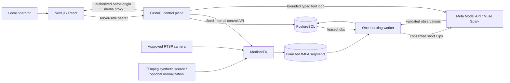

# System architecture — v0.1.0

**Phase 05 implementation:** [Video indexing/search](PHASE_05_INDEXING.md) now runs the
PostgreSQL-backed worker, real FFmpeg sampling, bounded Meta Files/Responses adapter,
grounded FTS retrieval and distinct activity data. Actual Meta video acceptance remains
unverified without credentials/budgets. Historical Phase 01 design statements follow.

**Implementation update:** [Phase 04 agent](PHASE_04_AGENT.md) adds the bounded Muse adapter,
typed executable capabilities, durable runs, approval, audit and verified layout writes.
Live Muse acceptance is gated by credentials. [Phase 03 VMS](PHASE_03_VMS.md) documents the running
camera/recording/layout services, API reconciler, authenticated media proxy and bounded MP4
cache. The Phase 01 implementation-status paragraphs below are retained as architecture history.

Contract frozen October 26, 2026. Ownership: Codex for API/AI/media; Claude for `apps/web`.
The smallest deployable target is one machine with Compose and persistent local volumes.

This diagram is the target MVP. Phase 01 implements app health, contract routes, catalog,
source admission policy, migration runner and probes. The worker, authenticated media proxy,
camera lifecycle, CRUD, agent execution and retrieval are not implemented yet.

## Components and decisions

- **Next.js 16.4.3, React 19.3.1, TypeScript**: App Router. Server components read API health
  today; Claude builds the VMS UI next. Generated `@veyra/contracts` types are mandatory.
  No provider key or camera credential may use `NEXT_PUBLIC_*`.
- **FastAPI/Pydantic**: one modular application. Pydantic owns REST types and OpenAPI;
  shared service functions will back both REST and agent tools. No direct model-to-DB access.
- **PostgreSQL 16 in Compose**: relational data, JSONB observation provenance, GIN text
  index, leased analysis queue, action audit and idempotency records. SQL is parameterized.
  Migrations are transactional, serialized by advisory lock and checksum-verified.
- **MediaMTX 1.21.3**: protocol routing, fMP4 recording and HTTP playback. It does not
  normalize arbitrary codecs into H264. Start with known H264 sources and TCP RTSP.
- **FFmpeg**: owned synthetic publisher, clip extraction, optional H265→H264 normalization.
  Invoke fixed argument arrays; source IDs and storage keys are resolved by the server.
  Users and models cannot pass flags, shell fragments or filenames.
- **One Python worker**: separate process, same codebase/dependency lock, PostgreSQL queue.
  No Redis/Celery/vector DB. It is reserved but deliberately absent from Compose in Phase 01.
- **Muse Spark**: first-party `https://api.meta.ai/v1`, Standard-mode `muse-spark-1.3`.
  Do not use Contributor mode for private camera footage. SAM 3.1 is optional and never blocks MVP.

## Slice 1: media lifecycle

1. An operator provisions `CAMERA_SOURCES_JSON` out of band. `GET /camera-sources` will
   expose only IDs/modes. Camera registration accepts an ID, a name and cloud consent.
2. Source admission permits only explicit RTSP(S) literal-IP endpoints within configured
   CIDRs. It blocks loopback, link-local/metadata, multicast, reserved and unspecified IPs,
   mapped IPv6, DNS names, query redirects and fragments. The module makes no network calls.
   Credentials live in server configuration, not camera rows. Narrow `/32` CIDRs are preferred.
3. API assigns `cam_<uuidhex>` as MediaMTX path and configures a pull through the fixed
   private control endpoint. Publisher mode is an explicitly provisioned technical fixture.
   Enable RTSP TCP; require known codec. API persists status `unknown` until MediaMTX reports
   a real source observation. Poll every two seconds; an observation older than ten seconds
   is stale/unknown, never implicitly online.
4. MediaMTX writes 10-second fMP4 segments with one-second parts. Reconcile finalized
   segments every two seconds with the recording list and filesystem/ffprobe. A segment only
   becomes `ready` after it is closed and its duration verified; open/partial parts are not indexed.
   No shell hooks that interpolate camera input. Deterministic segment identity/storage key
   prevents duplicates after reconnect or worker restart.
5. Group contiguous segments per camera into a recording; a gap greater than two seconds
   closes it and starts a new recording. Recording origin is actual first media time. Stored
   absolute timestamps come from MediaMTX/ffprobe, not from model estimates.
6. For browser live use HLS fMP4: native HLS on supported Safari, hls.js on MSE browsers.
   WebRTC is deferred; it adds ICE/network/codec dependencies with no benefit to this phase.
7. API returns a 5-minute `MediaSession` URL under `/api/v1/media/sessions/`. Resolve path,
   principal, permitted recording window and manifest segment mapping on the server. Rewrite
   HLS resources into that namespace; never proxy a request-supplied upstream URL/path.
   For MP4, first materialize a bounded MediaMTX export as a server-owned temporary cache
   file and serve it with FastAPI/Starlette FileResponse. Direct MediaMTX MP4 streaming did
   play, but exposed a zero-length seekable range in the Chromium probe. Do not assume it
   supports browser seeking. FileResponse supplies real Content-Length/Range/206/416 behavior.
   Bound cache size to 256MB total, delete on session expiry, and never use client filenames.
   The Next adapter must preserve Range and partial-response headers. Same-origin
   proxy preserves browser authentication; raw MediaMTX ports are never published by Compose.
8. Playback requests use recording-relative milliseconds. Use `start = recording.started_at
   + offset_ms`, select a verified available segment, and materialize a bounded MediaMTX MP4
   window in that cache. Return actual start and player seek offset. If frame-aligned output begins earlier,
   client seeks to `seek_offset_ms`; never silently play the beginning of the recording.
   Gaps return `409 MEDIA_GAP`; expired media returns `404 RECORDING_UNAVAILABLE`.

Default MediaMTX retention is 24h for development. The reconciler marks deleted segments
and invalidates metadata/search hits when files disappear. Playback always rechecks file
availability. Keep incomplete jobs out of search. Production retention coordination is deferred.

## Slice 2: bounded agent control plane

Use Chat Completions for the small app tool loop and JSON extraction. The transport is
server-side; there are no user-configurable base URLs. The final dispatcher will accept
only tools listed in AGENT_TOOLS. For each call: parse → Pydantic validation → principal/
resource permission → consent/confirmation → shared service → persisted audit/result.
Resolve camera names through authorized camera lookup; ask when ambiguous.

Use `tool_choice="auto"` and handle plain-text responses. Set `parallel_tool_calls=false`;
cap eight model turns, twelve tool calls, 60-second run time and 45-second HTTP request
timeouts. Retry only pre-execution transient provider failures, at most twice with jitter;
do not retry mutations outside their idempotency transaction. Reuse the complete assistant
tool-call message and return matching `tool_call_id`s. Model prose is never a success receipt.

Feature discovery is our static Veyra catalog, distinct from Meta's hosted `tool_search`.
Navigation returns a typed target; the frontend maps it to a fixed route. Layout creation
uses one DB transaction and durable action idempotency, then emits a layout navigation result.
Read-only requests cannot mutate. Missing explicit write intent creates a bound confirmation.

## Slice 3: indexing and search

Only manually requested cloud analysis is in MVP. Both camera consent and job acknowledgment
must be true. Recheck consent before every upload. Claim one queued job using `FOR UPDATE
SKIP LOCKED`; set a 60-second lease, renew every 15 seconds, and recover expired leases
up to three total attempts. Queue completion records verified segment coverage, not guessed progress.

Extract at most a 10-second, 640px-wide clip from each finalized segment; cap upload at 20MB
per clip and a job at 5 minutes/30 clips. These are **application budgets**, not claimed Meta
provider limits. Upload server-owned MP4 bytes with `purpose=user_data`, then call Responses
with `input_file.file_id` and `text.format` JSON Schema. Delete temporary files locally and
provider files after processing; log cleanup failures without exposing footage or keys.
Provider upload/retention limits still require a credentialed verification.
Request provider expiration (`created_at`, 3600 seconds) as a cleanup backstop, in addition
to explicit deletion. The documented Files API accepts up to 1GiB uploads; our 20MB budget
is deliberately smaller. Account quotas and actual latency remain untested without a key.
[Official file handling guide](https://dev.meta.ai/docs/file-handling).

Validate observations `{summary, evidence_text, start_ms, end_ms}` relative to the clip.
Reject negative/reversed/out-of-clip spans; enforce segment/job consistency. Persist model,
prompt/schema versions, sample offsets, actual recording/segment IDs and indexed_at. Time
grounding is computed by the worker: recording offset = segment offset + clip observation
offset. Model timestamps are estimates within media, never trusted wall-clock timestamps.

For search, Muse translates a natural-language query into bounded plain keywords and filters
using a strict schema. The server validates camera/time permissions and runs parameterized
PostgreSQL text search over actual successful metadata. Optional simple synonyms improve
small-corpus retrieval; no arbitrary generated SQL or tsquery operators. Hits include source
IDs, indexed text, model provenance, offsets and coverage. Ranking is not confidence. If
grounding or media is absent, return no result or a dependency error. No invented evidence.

No embedding endpoint is assumed. If the annotated demo set exposes lexical failures, expand
keywords or rerank the small authorized candidate set with Muse; measure quality before adding
a vector index. Clip/observation data are untrusted content and can never issue tool instructions.

## Local authorization and frontend boundary

This foundation is a **single trusted local operator** environment. All host bindings are
loopback. Protected API routes require `VEYRA_DEV_TOKEN`; token absent/example value fails
closed. No client-supplied user ID is trusted. It is not multi-user authentication.

Claude's next workstream adds a Next server-only API adapter. It must allowlist known paths
from OpenAPI, apply the server credential, reject unrecognized Host/Origin and cross-site
Fetch Metadata before proxying any request (including media), and never forward arbitrary
URLs or headers. `WEB_ORIGIN` pins the development origin. Native video requests use only
session-bound same-origin URLs; missing Origin is acceptable only with same-origin fetch
metadata and an approved Host. Non-browser local clients should use the bearer API directly.
Before any public deployment, add actual user sessions, CSRF protection and per-resource
authorization, TLS, media authentication and restricted media egress. Public deployment is
outside the agreed Phase 01 scope.

Compose isolates DB and media networks. The internal MediaMTX config grants trusted local
services API/read/playback access and fixture publish access; it is not safe for public ports.
The current internal-only media network supports the synthetic fixture. Physical LAN camera
pull will require an explicitly approved camera-egress connection restricted to the provisioned
source addresses; it is not enabled by the foundation Compose file. Resolve this in workstream A
alongside redirect handling rather than exposing media ports or attaching unrestricted egress.
Pull RTSP redirect behavior and network egress restrictions must be verified against physical
cameras before enabling general LAN ingest. The Phase 01 network fixture bypasses application
source admission solely to simulate a local RTSP camera; it does not weaken product policy.

## Failure policy

- Dependency readiness never implies model/media readiness. `/health/live` is process health;
  `/health/ready` checks the database and applied initial migration only.
- Camera disconnect closes observed recording spans; preserve ready files, never invent coverage.
- Job failure exposes a stable code, not provider headers/bodies; retries are bounded.
- A refused or malformed model response executes nothing. Partial multi-step work returns
  actual completed actions and a failed action, with no blanket success claim.
- Configuration, token and camera URL values never appear in error messages. API validation
  responses contain field paths only. No raw request/response body logging.

Official compatibility and actual probe outcomes are recorded in
[`FEASIBILITY.md`](FEASIBILITY.md). See [`DATA_MODEL.md`](DATA_MODEL.md) for consistency rules.
